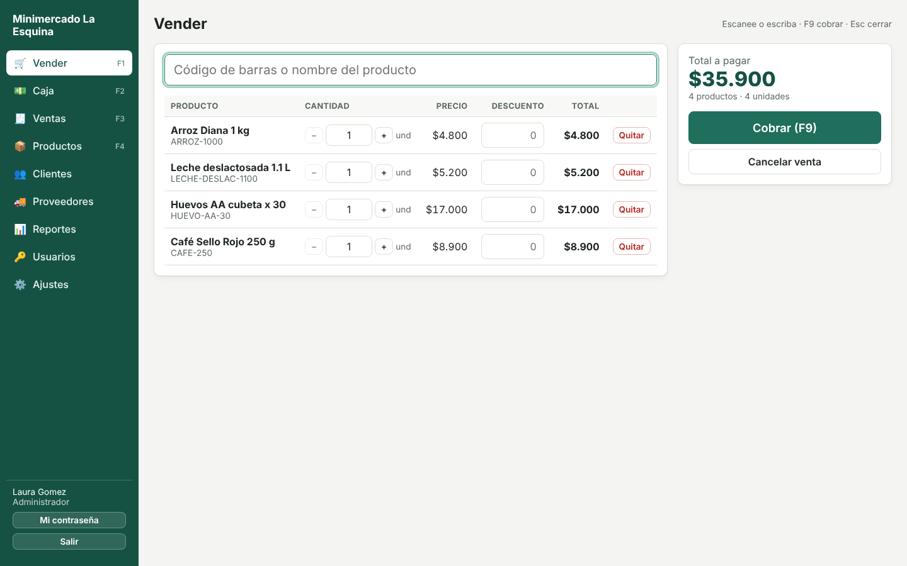
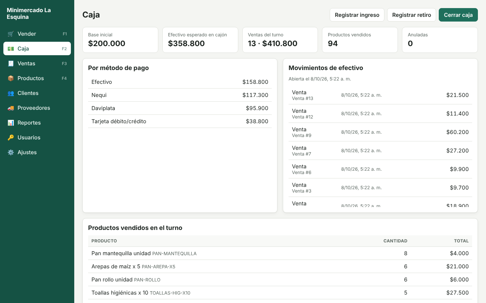
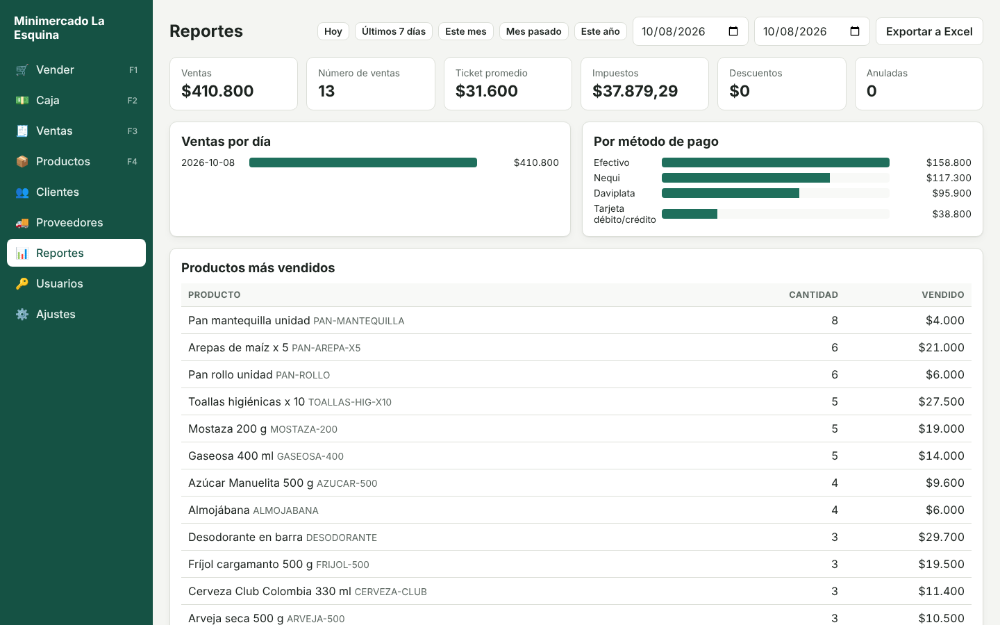
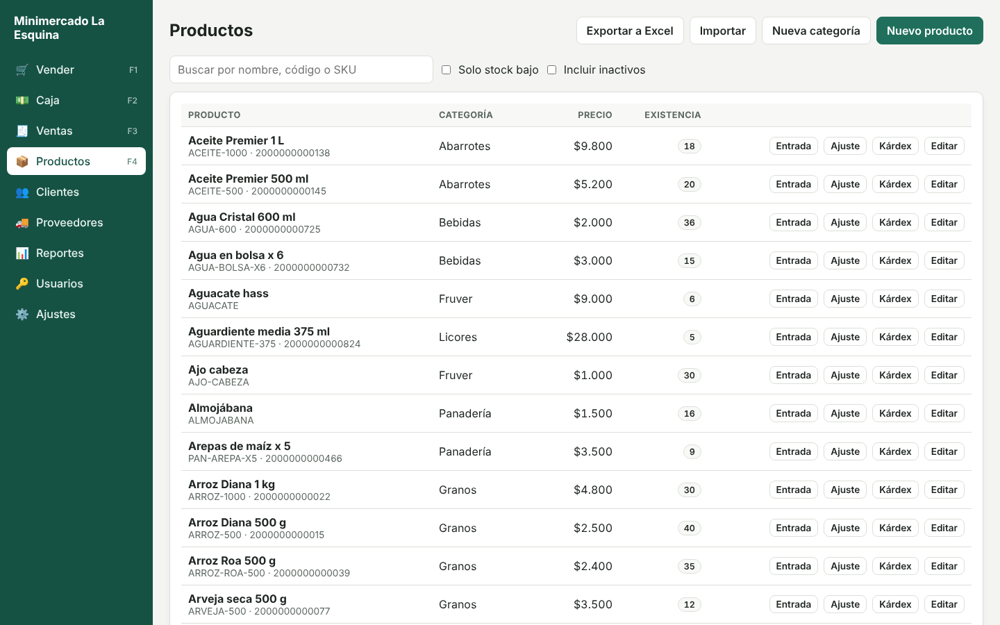
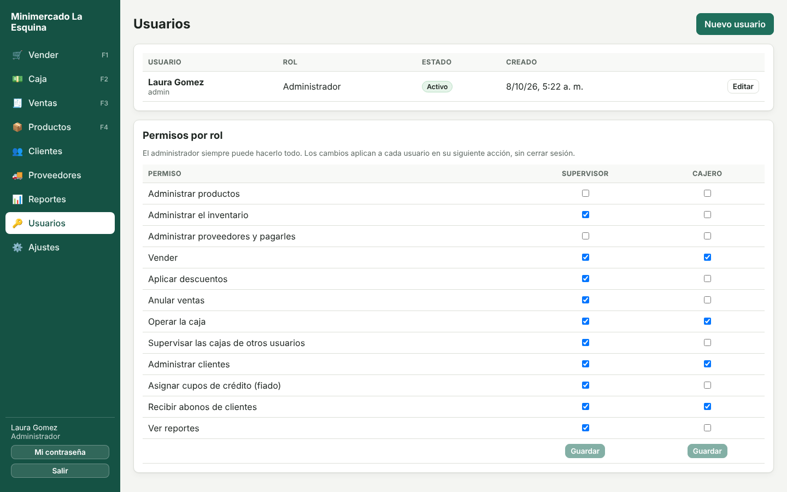
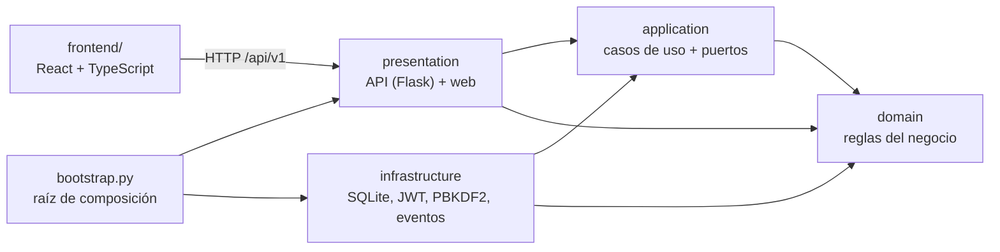

# Sistema POS para tiendas y restaurantes

[](https://github.com/santyxswc/SistemaPOS/actions/workflows/ci.yml)
[](https://github.com/santyxswc/SistemaPOS/releases)


Punto de venta completo para **tiendas, minimercados, cafeterías y restaurantes**, pensado para negocios reales en
Colombia: funciona sin internet en el computador del negocio, se instala con un `setup.exe` y se adapta a cada
cliente encendiendo o apagando módulos, sin tocar el código.



## Qué hace

| | |
| --- | --- |
| **Ventas** | Lector de código de barras, venta por unidad, kilo o libra, descuentos con permiso, pagos mixtos (efectivo, Nequi, Daviplata, tarjeta, fiado) y cálculo de vueltas. |
| **Caja** | Apertura con base, ingresos y retiros, cierre con arqueo y resumen por método de pago. |
| **Inventario** | Existencias, costo promedio, alertas de stock bajo y kárdex inmutable. |
| **Clientes y proveedores** | Fiado con cupo y abonos; compras a crédito y cuentas por pagar con vencimientos. |
| **Reportes** | Ventas por día y por método de pago, productos más vendidos y exportación a Excel para el contador. |
| **Usuarios** | Roles de administrador, supervisor y cajero, con permisos que el dueño ajusta. |
| **Operación** | Impresión directa en impresoras térmicas (ESC/POS) con apertura del cajón, respaldos automáticos, importación de productos desde Excel, bandeja de facturación electrónica y aviso de versiones nuevas. |

## Capturas

| Caja con arqueo | Reportes |
| --- | --- |
|  |  |
| **Productos e inventario** | **Permisos por rol** |
|  |  |

## Aspectos técnicos destacados

- **Arquitectura limpia** en cuatro capas con dependencias hacia el dominio; Flask, SQLite y React son detalles
  intercambiables. Más de diez patrones de diseño aplicados donde resuelven un problema concreto.
- **Dinero exacto**: `Decimal` en el servidor y centavos enteros en el navegador, nunca `float`.
- **Concurrencia segura**: dos cajas no pueden vender la misma última unidad (`BEGIN IMMEDIATE`) y las consultas
  usan transacciones de solo lectura en modo WAL que no bloquean a quien vende.
- **Ventas idempotentes**: si la red falla y la caja reintenta, la venta no se duplica (`Idempotency-Key`).
- **Seguridad**: PBKDF2-SHA256 con 600.000 iteraciones, JWT, freno de fuerza bruta, autorización en los casos de
  uso y licencias firmadas con Ed25519.
- **Módulos por cliente** (*feature toggles*) decididos en un solo lugar: rutas, permisos e interfaz se ajustan
  solos, sin `if` repartidos por el código.
- **Bandeja de salida (outbox)** para la facturación electrónica: el documento se guarda en la misma transacción
  de la venta y un proceso de fondo lo envía y reintenta.
- **Entrega profesional**: GitHub Actions prueba en Windows y Linux, compila el `.exe`, lo arranca, lo prueba y
  publica el instalador al crear una etiqueta.

## Inicio rápido

Requisitos: Python 3.11+ y Node 22+.

```bash
git clone https://github.com/santyxswc/SistemaPOS.git
cd SistemaPOS
python -m venv .venv
source .venv/bin/activate              # Windows: .venv\Scripts\activate
pip install -r requirements-dev.txt
cd frontend && npm install && npm run build && cd ..
python manage.py start                 # crea la base de datos y abre el navegador
```

La primera vez, el navegador pide el nombre del negocio y crea la cuenta del administrador. Para probar con datos,
importe `docs/ejemplos/productos-ejemplo.xlsx` desde **Productos → Importar**.

En un negocio real no hace falta Python: se ejecuta `PuntoDeVenta-<versión>-setup.exe` desde
[Releases](https://github.com/santyxswc/SistemaPOS/releases). Ver la [guía de instalación](docs/INSTALACION.md).

## Arquitectura

Arquitectura limpia en cuatro capas. Las dependencias siempre apuntan hacia adentro: el dominio no conoce a nadie, y Flask, SQLite y React son detalles intercambiables.



```
src/pos/
├── domain/              Reglas puras: sin frameworks ni base de datos
│   ├── shared/          Dinero (Decimal exacto), errores, entidades, eventos
│   ├── sales.py         Venta: líneas, impuestos, pagos mixtos, vueltas, anulación
│   ├── cash.py          Caja: base, ingresos, retiros, cierre con arqueo
│   ├── catalog.py       Productos con existencia, costo promedio y alerta de stock bajo
│   ├── customers.py     Clientes, cupo de crédito y estado de cuenta
│   ├── suppliers.py     Proveedores, compras y cuentas por pagar (pagos a la factura que vence primero)
│   ├── invoicing.py     Documentos electrónicos en bandeja de salida, con reintentos
│   ├── printing.py      Impresora de tiquetes configurada por el negocio
│   ├── payments.py      Tipos de pago y su comportamiento (Strategy)
│   ├── taxes.py         Impuesto incluido o agregado al precio (Strategy)
│   ├── settings.py      Configuración por negocio
│   ├── licensing.py     Plan, prueba y vencimiento de la licencia (módulo apagado de fábrica)
│   ├── branding.py      Logo del negocio (formatos aceptados, tamaño)
│   └── users.py         Roles y permisos (de fábrica y personalizados por el negocio)
├── application/
│   ├── modules.py       Catálogo de módulos opcionales, sus requisitos y sus permisos
│   ├── ports.py         Contratos: repositorios, unidad de trabajo, reportes, reloj, tokens...
│   ├── actor.py         Usuario actual y verificación de permisos
│   ├── receipts.py      El tiquete como documento (Builder), sin saber de impresoras
│   └── use_cases/       Un caso de uso por clase, agrupados por módulo
├── infrastructure/      Adaptadores: SQLite (+ reportes y respaldos), PBKDF2, JWT, licencias Ed25519, freno de login,
│                        ESC/POS (cola de Windows y red), proveedores de facturación, GitHub Releases, tareas de fondo
├── presentation/
│   ├── http/            Rutas Flask, validación de entrada, JSON y libros de Excel de salida
│   ├── desktop/         Ícono junto al reloj de Windows
│   ├── spreadsheets.py  Leer CSV/Excel y escribir Excel, sin dependencias externas
│   └── web/             Sirve la interfaz compilada
├── bootstrap.py         Conecta todas las piezas (inyección de dependencias)
└── config.py            Variables de entorno
frontend/src/
├── pages/               Una pantalla por archivo (Vender, Caja, Ventas, Productos...)
├── cart.ts, money.ts    Lógica pura del carrito y del dinero (con pruebas)
├── cartStore.ts         La venta en curso, que sobrevive al cambiar de pantalla
└── App.tsx              Menú armado con los módulos del negocio y los permisos del usuario
```

### SOLID y patrones, en el código

| Principio o patrón | Dónde se ve |
| --- | --- |
| Responsabilidad única | Cada caso de uso es una clase con un solo `execute` (`CreateSale`, `VoidSale`, `CloseCashSession`...). |
| Abierto/cerrado | Un método de pago nuevo es configuración; un tipo de pago nuevo es una entrada en `payments.py`. Una pantalla nueva es una entrada en `ROUTES` (`App.tsx`); una sección de Ajustes, una entrada en `SECTIONS`; un módulo, una entrada en `CATALOG`. |
| Sustitución de Liskov | `TaxIncludedPolicy` y `TaxExcludedPolicy` son intercambiables donde se espera una `TaxPolicy`. |
| Segregación de interfaces | Un puerto pequeño por necesidad (`Clock`, `PasswordHasher`, `TokenService`, `LoginThrottle`, `LicenseVerifier`, `BackupService`, un repositorio por agregado). |
| Inversión de dependencias | Los casos de uso dependen de `ports.py`; SQLite y JWT dependen de esos contratos, no al revés. |
| Unidad de trabajo | Una venta descuenta inventario, mueve la caja y carga el fiado en una sola transacción. Las consultas usan transacciones de solo lectura que no bloquean a quien vende. |
| CQRS ligero | Los reportes leen de `SalesReportQueries`, que suma en la base de datos, en lugar de cargar ventas completas. |
| Idempotencia | `POST /sales` con `Idempotency-Key`: si la red falla y la caja reintenta, la venta no se duplica. |
| Eventos de dominio | `SaleCompleted`, `StockLow` y `CashSessionClosed` se publican solo después de confirmar la transacción. Cerrar la caja dispara un respaldo sin que la caja sepa de respaldos. |
| Bandeja de salida (*outbox*) | El documento electrónico de cada venta se guarda en la misma transacción de la venta; un proceso de fondo lo envía y reintenta. El evento `DocumentQueued` lo despierta al instante (Observer). |
| Módulos (*feature toggles*) | `ModuleSet` decide al iniciar qué módulos existen: sus rutas se registran o no (`OPTIONAL_ROUTES`), sus permisos se quitan a todos los usuarios (`Actor.limited_to`) y la interfaz arma el menú con ellos. Sin `if` repartidos por el código. |
| Objeto nulo | `NoUserLimit`, `DisabledInvoiceOutbox` y `NoReleaseSource`: con el módulo apagado, el código que los usa no pregunta "¿está activo?". |
| Builder y Strategy | `ReceiptBuilder` arma el tiquete; `EscPosEncoder` lo traduce y el transporte (cola de Windows, red o archivo) se elige según la impresora configurada. |
| Fábrica | `create_invoice_provider` elige el proveedor de facturación por nombre (`POS_INVOICE_PROVIDER`). |
| Servicio de aplicación | `LicensePolicy` decide qué permite la licencia hoy; es el `UserQuota` de la instalación cuando el módulo de licencias está encendido. |
| Firma digital | Las licencias se firman con Ed25519: el programa trae solo la clave pública, así que puede comprobar una licencia pero no fabricarla. |
| Raíz de composición | `bootstrap.py` es el único archivo que conoce las clases concretas. |

## Calidad y pruebas

```bash
python -m pytest              # 218 pruebas del backend
cd frontend && npm test       # 28 pruebas del frontend
```

Backend: dominio puro, casos de uso sobre SQLite real, la API HTTP de punta a punta, concurrencia (dos cajas vendiendo la última unidad; lecturas que no esperan a quien escribe), migraciones sobre bases existentes, equivalencia de los reportes en SQL contra el cálculo del dominio, idempotencia, freno de login, respaldos (incluida una USB desconectada), módulos (rutas, permisos y fiado apagados; permisos ocultos que se conservan), logo, licencias (firma alterada, vencimiento, límite de usuarios), importación y exportación de Excel y CSV, compras y cuentas por pagar, permisos por rol, la bandeja de facturación con un proveedor falso (fallas, rechazos, notas crédito), el tiquete en ESC/POS con una impresora de red simulada y el aviso de versiones. Frontend: dinero y carrito, el flujo de venta en un DOM simulado (cobro con vueltas, reintento tras falla de red, validaciones, permisos, impresión directa), la activación de la licencia, la importación de productos, las compras, los permisos por rol, la revisión de documentos electrónicos, el aviso de versión nueva, los módulos apagados y la subida del logo. GitHub Actions corre todo en Windows y Linux en cada cambio.

## Decisiones técnicas

- **Dinero con `Decimal`** en el servidor y **centavos enteros** en el navegador, nunca `float`. Los reportes suman en centavos enteros dentro de SQLite.
- **SQLite en el computador del negocio**: nada que instalar y funciona sin internet. Las ventas usan `BEGIN IMMEDIATE` (dos cajeros no venden la misma última unidad); las consultas, transacciones de solo lectura en modo WAL.
- **Fechas en UTC** y reportes en la zona horaria del negocio (`America/Bogota` por defecto).
- **Precio desde el catálogo**: el cliente de la API envía cantidades, nunca precios. Los descuentos piden permiso.
- **Contraseñas con PBKDF2-SHA256** (600.000 iteraciones), sesiones con JWT firmados y bloqueo de 5 minutos tras 5 intentos fallidos. El login tarda lo mismo exista o no el usuario.
- **Autorización en los casos de uso**, no en las rutas ni en la interfaz: el menú oculta lo que no se puede usar, pero quien decide es el servidor.
- **Historial inmutable**: kárdex, movimientos de caja y estado de cuenta nunca se editan, solo se agregan.
- **Migraciones versionadas** (`PRAGMA user_version`), en SQL o en Python cuando hay que transformar datos con reglas del dominio.

## Documentación

| Documento | Contenido |
| --- | --- |
| [`docs/INSTALACION.md`](docs/INSTALACION.md) | Instalar en un negocio, publicar versiones, comandos y soporte |
| [`docs/MODULOS.md`](docs/MODULOS.md) | Encender o apagar funciones por cliente |
| [`docs/PERSONALIZACION.md`](docs/PERSONALIZACION.md) | Ajustes sin código y recetas para extender el sistema |
| [`docs/API.md`](docs/API.md) | Rutas de la API HTTP, formato de errores y códigos de estado |
| [`docs/ROADMAP.md`](docs/ROADMAP.md) | Próximas funciones y limitaciones conocidas |
| [`CONTRIBUTING.md`](CONTRIBUTING.md) | Entorno de desarrollo y reglas del proyecto |
| [`CHANGELOG.md`](CHANGELOG.md) | Historial de versiones |

## Autor

**Santiago Caicedo** — [@santyxswc](https://github.com/santyxswc)
