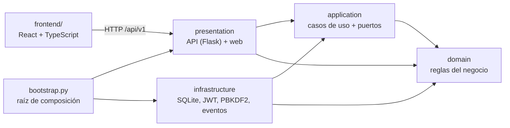

# Sistema POS para negocios pequeños

Punto de venta para tiendas, minimercados, cafeterías y restaurantes pequeños: ventas con lector de código de barras, caja diaria con arqueo, pagos en efectivo, Nequi, Daviplata, tarjeta, mixtos y fiado, usuarios con roles (administrador, supervisor y cajero) y permisos que el dueño ajusta, inventario con alertas y kárdex, proveedores con compras y cuentas por pagar, clientes con cuentas por cobrar, reportes, impresión directa en impresoras térmicas con apertura del cajón, bandeja de salida para la facturación electrónica, carga de productos desde Excel, exportación para el contador, respaldos automáticos, aviso de versiones nuevas y licencias por plan.

El mismo código sirve para cualquier negocio: lo que cambia de un cliente a otro (impuestos, métodos de pago, fiados, carpeta de respaldo) es **configuración** que el dueño cambia desde la pantalla de Ajustes; el plan comprado (cuántos usuarios) lo fija una **licencia firmada** que el negocio no puede alterar; y lo que necesita código nuevo (otra base de datos, facturación electrónica) entra por **puntos de extensión** sin tocar las reglas de negocio.

## Instalación en el computador de un cliente (Windows)

El cliente **no necesita instalar Python ni nada más**.

1. Ejecute **`PuntoDeVenta-<versión>-setup.exe`**. No pide permisos de administrador; ofrece crear un acceso directo en el escritorio, abrir el sistema al encender el computador y programar el respaldo diario.
2. Abra **Punto de Venta**. La primera vez, el navegador pide el nombre del negocio y crea la cuenta del administrador.
3. Cargue los productos desde Excel (**Productos → Importar**; hay una plantilla de ejemplo) y, en **Ajustes**, elija una carpeta de respaldo adicional (USB u OneDrive) y pegue el código de licencia.

El sistema no abre ventanas negras: queda como un **ícono junto al reloj de Windows** con un menú para abrirlo, respaldar ahora, abrir la carpeta de datos o apagarlo. Abrirlo de nuevo cuando ya está abierto solo abre el navegador. Los comandos de soporte (`reset-password`, `license`) se ejecutan con **`PuntoDeVentaConsola.exe`**, que es el mismo programa con consola.

Sin instalador, el `.zip` sirve igual: descomprima la carpeta `PuntoDeVenta` y abra `PuntoDeVenta.exe`.

| Qué | Dónde |
| --- | --- |
| Programa | `%LOCALAPPDATA%\Programs\PuntoDeVenta` (lo reemplaza cada actualización) |
| Datos del negocio | `%LOCALAPPDATA%\PuntoDeVenta`: `.env`, `data\pos.sqlite3`, `data\backups`, `logs\pos.log` |

Actualizar es ejecutar el instalador de la versión nueva: los datos no se tocan y la base de datos se actualiza sola al abrir. Desinstalar tampoco borra los datos.

**Respaldos**: se hace uno al cerrar cada caja y, si se eligió al instalar, otro todos los días a las 10 p. m. (se conservan los últimos 30). En **Ajustes → Respaldos** se puede respaldar en cualquier momento y elegir una carpeta adicional (USB, OneDrive o Google Drive) donde se copia cada respaldo: así sobreviven a un disco dañado o a un robo. Para restaurar, cierre el sistema y reemplace `data\pos.sqlite3` por el respaldo elegido.

**Licencia**: sin licencia, el sistema funciona completo 30 días. Después sigue vendiendo, pero no permite más de un usuario activo hasta que se pegue un código en **Ajustes → Licencia** (o `PuntoDeVentaConsola.exe license CODIGO`). Los códigos se emiten con `packaging/licencia.py`, que solo tiene el proveedor (ver `docs/HOJA_DE_RUTA.md`).

**Red local**: para usarlo desde otros computadores, ponga `POS_HOST=0.0.0.0` en el `.env` de la carpeta de datos y entre a `http://IP-DEL-SERVIDOR:8000`.

### Publicar una versión

1. Suba la versión en `src/pos/__init__.py`, `pyproject.toml` y `frontend/package.json`.
2. Cree y publique la etiqueta: `git tag v0.3.0 && git push origin v0.3.0`.
3. GitHub Actions ("Versión para Windows") compila la interfaz, empaqueta el `.exe`, lo **arranca y prueba**, y publica un *Release* con el `.zip` y el `setup.exe`. Si la etiqueta no coincide con la versión del código, falla.

Para construirla en su propio computador (necesita Node; el `setup.exe` solo si tiene [Inno Setup 6](https://jrsoftware.org/isinfo.php)):

```bash
pip install -r requirements-build.txt
python packaging/build.py          # resultado en dist/
```

Windows mostrará "Windows protegió su PC" al abrir un instalador sin firma digital: el cliente debe pulsar *Más información → Ejecutar de todas formas*. Para quitar el aviso hace falta un certificado de firma de código.

### Sin instalador, desde el código fuente

Con [Python 3.11+](https://www.python.org/downloads/): `instalar.bat` prepara el entorno e `iniciar-pos.bat` abre el sistema. `respaldo.bat` hace la copia de seguridad.

## Desarrollo

```bash
python -m venv .venv
.venv\Scripts\activate                 # Windows  (Linux/macOS: source .venv/bin/activate)
pip install -r requirements-dev.txt
python manage.py start                 # crea .env y la base de datos; el navegador pide el resto
```

En `.env` ponga `POS_ENV=development` y en dos terminales:

```bash
python manage.py runserver             # API en http://127.0.0.1:8000
cd frontend && npm install && npm run dev   # interfaz con recarga en http://localhost:5173
```

Los mismos comandos funcionan con `PuntoDeVenta.exe <comando>`:

| Comando | Qué hace |
| --- | --- |
| `start` (por defecto) | Prepara una instalación nueva si hace falta, inicia el sistema y abre el navegador. |
| `init` | Instalación desde la consola. `POS_ADMIN_PASSWORD` permite hacerla sin preguntas. |
| `runserver [--open]` | Solo el servidor; con `POS_ENV=development`, el de Flask con recarga. |
| `backup [--dir] [--keep 30]` | Respaldo en caliente, verificado con `integrity_check`; también lo copia a la carpeta adicional de Ajustes. |
| `create-admin` | Crea el primer administrador. |
| `reset-password --username X` | Contraseña nueva para un usuario (soporte, cuando el dueño la olvida). `POS_NEW_PASSWORD` la evita escribir. |
| `license [CODIGO]` | Muestra el estado de la licencia o instala un código. |

## Arquitectura

Arquitectura limpia en cuatro capas. Las dependencias siempre apuntan hacia adentro: el dominio no conoce a nadie, y Flask, SQLite y React son detalles intercambiables.



```
src/pos/
├── domain/              Reglas puras: sin frameworks ni base de datos
│   ├── shared/          Dinero (Decimal exacto), errores, entidades, eventos
│   ├── sales.py         Venta: líneas, impuestos, pagos mixtos, vueltas, anulación
│   ├── cash.py          Caja: base, ingresos, retiros, cierre con arqueo
│   ├── catalog.py       Productos con existencia, costo promedio y alerta de stock bajo
│   ├── customers.py     Clientes, cupo de crédito y estado de cuenta
│   ├── suppliers.py     Proveedores, compras y cuentas por pagar (pagos a la factura que vence primero)
│   ├── invoicing.py     Documentos electrónicos en bandeja de salida, con reintentos
│   ├── printing.py      Impresora de tiquetes configurada por el negocio
│   ├── payments.py      Tipos de pago y su comportamiento (Strategy)
│   ├── taxes.py         Impuesto incluido o agregado al precio (Strategy)
│   ├── settings.py      Configuración por negocio
│   ├── licensing.py     Plan, prueba y vencimiento de la licencia (reglas comerciales)
│   └── users.py         Roles y permisos (de fábrica y personalizados por el negocio)
├── application/
│   ├── ports.py         Contratos: repositorios, unidad de trabajo, reportes, reloj, tokens...
│   ├── actor.py         Usuario actual y verificación de permisos
│   ├── receipts.py      El tiquete como documento (Builder), sin saber de impresoras
│   └── use_cases/       Un caso de uso por clase, agrupados por módulo
├── infrastructure/      Adaptadores: SQLite (+ reportes y respaldos), PBKDF2, JWT, licencias Ed25519, freno de login,
│                        ESC/POS (cola de Windows y red), proveedores de facturación, GitHub Releases, tareas de fondo
├── presentation/
│   ├── http/            Rutas Flask, validación de entrada, JSON y libros de Excel de salida
│   ├── desktop/         Ícono junto al reloj de Windows
│   ├── spreadsheets.py  Leer CSV/Excel y escribir Excel, sin dependencias externas
│   └── web/             Sirve la interfaz compilada
├── bootstrap.py         Conecta todas las piezas (inyección de dependencias)
└── config.py            Variables de entorno
frontend/src/
├── pages/               Una pantalla por archivo (Vender, Caja, Ventas, Productos...)
├── cart.ts, money.ts    Lógica pura del carrito y del dinero (con pruebas)
└── App.tsx              Menú armado con los permisos del usuario
```

### SOLID y patrones, en el código

| Principio o patrón | Dónde se ve |
| --- | --- |
| Responsabilidad única | Cada caso de uso es una clase con un solo `execute` (`CreateSale`, `VoidSale`, `CloseCashSession`...). |
| Abierto/cerrado | Un método de pago nuevo es configuración; un tipo de pago nuevo es una entrada en `payments.py`. Una pantalla nueva es una entrada en `ROUTES` (`App.tsx`). |
| Sustitución de Liskov | `TaxIncludedPolicy` y `TaxExcludedPolicy` son intercambiables donde se espera una `TaxPolicy`. |
| Segregación de interfaces | Un puerto pequeño por necesidad (`Clock`, `PasswordHasher`, `TokenService`, `LoginThrottle`, `LicenseVerifier`, `BackupService`, un repositorio por agregado). |
| Inversión de dependencias | Los casos de uso dependen de `ports.py`; SQLite y JWT dependen de esos contratos, no al revés. |
| Unidad de trabajo | Una venta descuenta inventario, mueve la caja y carga el fiado en una sola transacción. Las consultas usan transacciones de solo lectura que no bloquean a quien vende. |
| CQRS ligero | Los reportes leen de `SalesReportQueries`, que suma en la base de datos, en lugar de cargar ventas completas. |
| Idempotencia | `POST /sales` con `Idempotency-Key`: si la red falla y la caja reintenta, la venta no se duplica. |
| Eventos de dominio | `SaleCompleted`, `StockLow` y `CashSessionClosed` se publican solo después de confirmar la transacción. Cerrar la caja dispara un respaldo sin que la caja sepa de respaldos. |
| Bandeja de salida (*outbox*) | El documento electrónico de cada venta se guarda en la misma transacción de la venta; un proceso de fondo lo envía y reintenta. El evento `DocumentQueued` lo despierta al instante (Observer). |
| Objeto nulo | `DisabledInvoiceOutbox` y `NoReleaseSource`: sin facturación ni aviso de versiones, el código que los usa no pregunta "¿está activo?". |
| Builder y Strategy | `ReceiptBuilder` arma el tiquete; `EscPosEncoder` lo traduce y el transporte (cola de Windows, red o archivo) se elige según la impresora configurada. |
| Fábrica | `create_invoice_provider` elige el proveedor de facturación por nombre (`POS_INVOICE_PROVIDER`). |
| Servicio de aplicación | `LicensePolicy` decide qué permite la licencia hoy; lo usan los casos de uso de usuarios (y mañana las funciones que se vendan aparte). |
| Firma digital | Las licencias se firman con Ed25519: el programa trae solo la clave pública, así que puede comprobar una licencia pero no fabricarla. |
| Raíz de composición | `bootstrap.py` es el único archivo que conoce las clases concretas. |

## Cómo adaptarlo a cada negocio

Sin escribir código, desde **Ajustes** (o `PATCH /api/v1/settings`):

| Necesidad del cliente | Ajuste |
| --- | --- |
| Restaurante con impuesto al consumo del 8 % | Impuesto por defecto `8` |
| Precios sin impuesto (ventas a empresas) | Desmarcar "Los precios ya incluyen el impuesto" |
| Acepta Bancolombia o transferencias | Agregar un método de tipo electrónico |
| No fía | Desmarcar "Permitir ventas fiadas" |
| Vende aunque el sistema marque cero existencias | Marcar la opción correspondiente |
| Datos del tiquete | Nombre, NIT, dirección, teléfono y mensaje al pie |
| Copia de los respaldos fuera del computador | Ajustes → Respaldos → Carpeta adicional |
| Encargado de turno que anula ventas pero no cambia precios | Usuario con rol Supervisor |
| Que el cajero vea reportes, o que no reciba abonos | Usuarios → Permisos por rol |
| Imprimir sin el cuadro del navegador y abrir el cajón | Ajustes → Impresora de tiquetes (Windows o de red) |
| Compras a crédito a los proveedores | Proveedores → Registrar compra, forma de pago "A crédito" |
| Límite de usuarios según el plan vendido | Licencia: `python packaging/licencia.py emitir --usuarios 3 ...` (ya no es un ajuste: el cliente no lo puede cambiar) |

Con código, en los puntos de extensión previstos:

- **Facturación electrónica DIAN**: crear una clase con el método `issue(document, sale, settings)` que llame al API de un proveedor autorizado, registrarla en `PROVIDERS` (`infrastructure/invoicing.py`) y activarla con `POS_INVOICE_PROVIDER`. La bandeja de salida, los reintentos, la nota crédito de las anulaciones y la pantalla de revisión ya funcionan (pruébelos con `POS_INVOICE_PROVIDER=simulado`).
- **PostgreSQL o la nube**: implementar los repositorios, `SalesReportQueries` y la unidad de trabajo de `application/ports.py` en `infrastructure/persistence/postgres/` y cambiar una línea en `bootstrap.py`.
- **Varios servidores**: reemplazar `InMemoryLoginThrottle` por una implementación compartida (p. ej. Redis).
- **Permisos de fábrica de un rol**: `ROLE_PERMISSIONS` en `domain/users.py` (cada negocio los ajusta después en Usuarios).
- **Otra impresora** (PDF, tiquete por WhatsApp): otra implementación de `ReceiptPrinter` que traduzca el `ReceiptDocument`.
- **Alertas por WhatsApp o correo**: suscribir un manejador a `StockLow` o `CashSessionClosed` en `bootstrap.py`.

## API

Todas las rutas, salvo el login y `/health`, piden el encabezado `Authorization: Bearer <token>`. El dinero viaja como texto (`"12500.00"`) para no perder exactitud.

```http
POST /api/v1/auth/login
{"username": "admin", "password": "..."}

POST /api/v1/sales
Idempotency-Key: 6f1c2a0e-...   (opcional, recomendado: la misma clave en cada reintento)
{
  "items": [{"product_id": "…", "quantity": 2}],
  "payments": [{"method": "nequi", "amount": "3000"}, {"method": "efectivo", "amount": "5000"}]
}
```

| Módulo | Rutas (prefijo `/api/v1`) |
| --- | --- |
| Acceso | `POST /auth/login`, `GET /auth/me`, `POST /auth/change-password` |
| Usuarios | `GET /users`, `POST /users`, `PATCH /users/{id}`, `GET /roles`, `PUT /roles/{rol}` (`{"permissions": [...]}` o `{"reset": true}`) |
| Configuración | `GET /settings`, `PATCH /settings`, `GET /updates` |
| Licencia | `GET /license`, `POST /license` (`{"code": "POS1...."}`) |
| Respaldos | `GET /backups`, `POST /backups` |
| Catálogo | `GET/POST /categories`, `GET/POST /products`, `GET /products/lookup?code=`, `GET/PATCH /products/{id}`, `GET /products/export` (Excel), `GET /products/import-template`, `POST /products/import?dry_run=true&update_existing=false` (archivo en `file`) |
| Inventario | `POST /inventory/purchases`, `POST /inventory/adjustments`, `GET /inventory/low-stock`, `GET /inventory/movements?product_id=` |
| Caja | `POST /cash-sessions`, `GET /cash-sessions`, `GET /cash-sessions/current`, `POST /cash-sessions/current/movements`, `POST /cash-sessions/current/close`, `POST /cash-sessions/{id}/close`, `GET /cash-sessions/{id}` |
| Ventas | `POST /sales`, `GET /sales?from=&to=`, `GET /sales/{id}`, `POST /sales/{id}/void`, `POST /sales/{id}/print` (`{"copy": true}` para reimprimir) |
| Impresión | `GET /printing/printers`, `POST /printing/test`, `POST /cash-drawer/open` |
| Proveedores | `GET/POST /suppliers`, `GET/PATCH /suppliers/{id}`, `GET /suppliers/{id}/statement`, `POST /suppliers/{id}/payments`, `GET /suppliers/payables` |
| Compras | `POST /purchases` (forma de pago `cash_drawer`, `external` o `credit`), `GET /purchases?pending=1&supplier_id=`, `GET /purchases/{id}` |
| Facturación electrónica | `GET /invoicing`, `GET /invoicing/documents?status=failed,rejected`, `POST /invoicing/documents/{id}/retry` |
| Clientes | `GET/POST /customers`, `GET/PATCH /customers/{id}`, `GET /customers/{id}/statement`, `POST /customers/{id}/payments` |
| Reportes | `GET /reports/sales-summary?from=&to=&group_by=month`, `GET /reports/top-products?from=&to=`, `GET /reports/export?from=&to=` (Excel para el contador) |

Todos los errores tienen la misma forma, con mensajes listos para mostrar al usuario:

```json
{"error": {"code": "insufficient_stock", "message": "Stock insuficiente de «Arroz 500 g»: hay 1 y se piden 2"}}
```

400 dato inválido, 401 sin sesión, 403 sin permiso, 404 no existe, 409 duplicado o conflicto, 422 regla de negocio, 429 demasiados intentos de inicio de sesión.

## Pruebas

```bash
python -m pytest              # 203 pruebas del backend
cd frontend && npm test       # 25 pruebas del frontend
```

Backend: dominio puro, casos de uso sobre SQLite real, la API HTTP de punta a punta, concurrencia (dos cajas vendiendo la última unidad; lecturas que no esperan a quien escribe), migraciones sobre bases existentes, equivalencia de los reportes en SQL contra el cálculo del dominio, idempotencia, freno de login, respaldos (incluida una USB desconectada), licencias (firma alterada, vencimiento, límite de usuarios), importación y exportación de Excel y CSV, compras y cuentas por pagar, permisos por rol, la bandeja de facturación con un proveedor falso (fallas, rechazos, notas crédito), el tiquete en ESC/POS con una impresora de red simulada y el aviso de versiones. Frontend: dinero y carrito, el flujo de venta en un DOM simulado (cobro con vueltas, reintento tras falla de red, validaciones, permisos, impresión directa), la activación de la licencia, la importación de productos, las compras, los permisos por rol, la revisión de documentos electrónicos y el aviso de versión nueva. GitHub Actions corre todo en Windows y Linux en cada cambio.

## Decisiones técnicas

- **Dinero con `Decimal`** en el servidor y **centavos enteros** en el navegador, nunca `float`. Los reportes suman en centavos enteros dentro de SQLite.
- **SQLite en el computador del negocio**: nada que instalar y funciona sin internet. Las ventas usan `BEGIN IMMEDIATE` (dos cajeros no venden la misma última unidad); las consultas, transacciones de solo lectura en modo WAL.
- **Fechas en UTC** y reportes en la zona horaria del negocio (`America/Bogota` por defecto).
- **Precio desde el catálogo**: el cliente de la API envía cantidades, nunca precios. Los descuentos piden permiso.
- **Contraseñas con PBKDF2-SHA256** (600.000 iteraciones), sesiones con JWT firmados y bloqueo de 5 minutos tras 5 intentos fallidos. El login tarda lo mismo exista o no el usuario.
- **Autorización en los casos de uso**, no en las rutas ni en la interfaz: el menú oculta lo que no se puede usar, pero quien decide es el servidor.
- **Historial inmutable**: kárdex, movimientos de caja y estado de cuenta nunca se editan, solo se agregan.
- **Migraciones versionadas** (`PRAGMA user_version`), en SQL o en Python cuando hay que transformar datos con reglas del dominio.

## Próximos pasos

El plan detallado, con prioridades y riesgos, está en [`docs/HOJA_DE_RUTA.md`](docs/HOJA_DE_RUTA.md). En resumen:

1. Conectar un proveedor de facturación electrónica autorizado por la DIAN (la bandeja de salida ya está lista).
2. Probar la impresión directa con impresoras térmicas reales y el lector de código de barras.
3. Respaldo automático en la nube como servicio.
4. Adaptador PostgreSQL para clientes con varias sedes o en la nube.
5. Firma digital del instalador.
