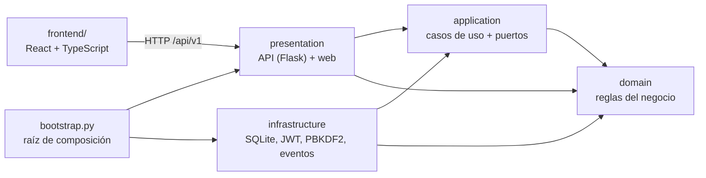

# Sistema POS para negocios pequeños

Punto de venta para tiendas, minimercados, cafeterías y restaurantes pequeños: ventas con lector de código de barras, caja diaria con arqueo, pagos en efectivo, Nequi, Daviplata, tarjeta, mixtos y fiado, usuarios con roles, inventario con alertas y kárdex, clientes con cuentas por cobrar, reportes y tiquete para impresora térmica.

El mismo código sirve para cualquier negocio: lo que cambia de un cliente a otro (impuestos, métodos de pago, límite de usuarios, fiados) es **configuración** que el dueño cambia desde la pantalla de Ajustes, y lo que necesita código nuevo (otra base de datos, facturación electrónica) entra por **puntos de extensión** sin tocar las reglas de negocio.

## Instalación en el computador de un cliente (Windows)

El cliente **no necesita instalar Python ni nada más**.

1. Ejecute **`PuntoDeVenta-<versión>-setup.exe`**. No pide permisos de administrador; ofrece crear un acceso directo en el escritorio y programar el respaldo diario.
2. Abra **Punto de Venta**. La primera vez, el navegador pide el nombre del negocio y crea la cuenta del administrador.

La ventana negra que acompaña al sistema muestra la dirección; cerrarla apaga el sistema. Abrirlo de nuevo cuando ya está abierto solo abre el navegador.

Sin instalador, el `.zip` sirve igual: descomprima la carpeta `PuntoDeVenta` y abra `PuntoDeVenta.exe`.

| Qué | Dónde |
| --- | --- |
| Programa | `%LOCALAPPDATA%\Programs\PuntoDeVenta` (lo reemplaza cada actualización) |
| Datos del negocio | `%LOCALAPPDATA%\PuntoDeVenta`: `.env`, `data\pos.sqlite3`, `data\backups`, `logs\pos.log` |

Actualizar es ejecutar el instalador de la versión nueva: los datos no se tocan y la base de datos se actualiza sola al abrir. Desinstalar tampoco borra los datos.

**Respaldos**: el instalador puede programar uno diario a las 10 p. m. (conserva los últimos 30); también hay un acceso "Copia de seguridad del Punto de Venta" en el menú Inicio. Para restaurar, cierre el sistema y reemplace `data\pos.sqlite3` por el respaldo elegido.

**Red local**: para usarlo desde otros computadores, ponga `POS_HOST=0.0.0.0` en el `.env` de la carpeta de datos y entre a `http://IP-DEL-SERVIDOR:8000`.

### Publicar una versión

1. Suba la versión en `src/pos/__init__.py`, `pyproject.toml` y `frontend/package.json`.
2. Cree y publique la etiqueta: `git tag v0.3.0 && git push origin v0.3.0`.
3. GitHub Actions ("Versión para Windows") compila la interfaz, empaqueta el `.exe`, lo **arranca y prueba**, y publica un *Release* con el `.zip` y el `setup.exe`. Si la etiqueta no coincide con la versión del código, falla.

Para construirla en su propio computador (necesita Node; el `setup.exe` solo si tiene [Inno Setup 6](https://jrsoftware.org/isinfo.php)):

```bash
pip install -r requirements-build.txt
python packaging/build.py          # resultado en dist/
```

Windows mostrará "Windows protegió su PC" al abrir un instalador sin firma digital: el cliente debe pulsar *Más información → Ejecutar de todas formas*. Para quitar el aviso hace falta un certificado de firma de código.

### Sin instalador, desde el código fuente

Con [Python 3.11+](https://www.python.org/downloads/): `instalar.bat` prepara el entorno e `iniciar-pos.bat` abre el sistema. `respaldo.bat` hace la copia de seguridad.

## Desarrollo

```bash
python -m venv .venv
.venv\Scripts\activate                 # Windows  (Linux/macOS: source .venv/bin/activate)
pip install -r requirements-dev.txt
python manage.py start                 # crea .env y la base de datos; el navegador pide el resto
```

En `.env` ponga `POS_ENV=development` y en dos terminales:

```bash
python manage.py runserver             # API en http://127.0.0.1:8000
cd frontend && npm install && npm run dev   # interfaz con recarga en http://localhost:5173
```

Los mismos comandos funcionan con `PuntoDeVenta.exe <comando>`:

| Comando | Qué hace |
| --- | --- |
| `start` (por defecto) | Prepara una instalación nueva si hace falta, inicia el sistema y abre el navegador. |
| `init` | Instalación desde la consola. `POS_ADMIN_PASSWORD` permite hacerla sin preguntas. |
| `runserver [--open]` | Solo el servidor; con `POS_ENV=development`, el de Flask con recarga. |
| `backup [--dir] [--keep 30]` | Respaldo en caliente, verificado con `integrity_check`. |
| `create-admin` | Crea el primer administrador. |

## Arquitectura

Arquitectura limpia en cuatro capas. Las dependencias siempre apuntan hacia adentro: el dominio no conoce a nadie, y Flask, SQLite y React son detalles intercambiables.



```
src/pos/
├── domain/              Reglas puras: sin frameworks ni base de datos
│   ├── shared/          Dinero (Decimal exacto), errores, entidades, eventos
│   ├── sales.py         Venta: líneas, impuestos, pagos mixtos, vueltas, anulación
│   ├── cash.py          Caja: base, ingresos, retiros, cierre con arqueo
│   ├── catalog.py       Productos con existencia, costo promedio y alerta de stock bajo
│   ├── customers.py     Clientes, cupo de crédito y estado de cuenta
│   ├── payments.py      Tipos de pago y su comportamiento (Strategy)
│   ├── taxes.py         Impuesto incluido o agregado al precio (Strategy)
│   ├── settings.py      Configuración por negocio
│   └── users.py         Roles y permisos
├── application/
│   ├── ports.py         Contratos: repositorios, unidad de trabajo, reportes, reloj, tokens...
│   ├── actor.py         Usuario actual y verificación de permisos
│   └── use_cases/       Un caso de uso por clase, agrupados por módulo
├── infrastructure/      Adaptadores: SQLite (+ reportes y respaldos), PBKDF2, JWT, freno de login
├── presentation/
│   ├── http/            Rutas Flask, validación de entrada y JSON de salida
│   └── web/             Sirve la interfaz compilada
├── bootstrap.py         Conecta todas las piezas (inyección de dependencias)
└── config.py            Variables de entorno
frontend/src/
├── pages/               Una pantalla por archivo (Vender, Caja, Ventas, Productos...)
├── cart.ts, money.ts    Lógica pura del carrito y del dinero (con pruebas)
└── App.tsx              Menú armado con los permisos del usuario
```

### SOLID y patrones, en el código

| Principio o patrón | Dónde se ve |
| --- | --- |
| Responsabilidad única | Cada caso de uso es una clase con un solo `execute` (`CreateSale`, `VoidSale`, `CloseCashSession`...). |
| Abierto/cerrado | Un método de pago nuevo es configuración; un tipo de pago nuevo es una entrada en `payments.py`. Una pantalla nueva es una entrada en `ROUTES` (`App.tsx`). |
| Sustitución de Liskov | `TaxIncludedPolicy` y `TaxExcludedPolicy` son intercambiables donde se espera una `TaxPolicy`. |
| Segregación de interfaces | Un puerto pequeño por necesidad (`Clock`, `PasswordHasher`, `TokenService`, `LoginThrottle`, un repositorio por agregado). |
| Inversión de dependencias | Los casos de uso dependen de `ports.py`; SQLite y JWT dependen de esos contratos, no al revés. |
| Unidad de trabajo | Una venta descuenta inventario, mueve la caja y carga el fiado en una sola transacción. Las consultas usan transacciones de solo lectura que no bloquean a quien vende. |
| CQRS ligero | Los reportes leen de `SalesReportQueries`, que suma en la base de datos, en lugar de cargar ventas completas. |
| Idempotencia | `POST /sales` con `Idempotency-Key`: si la red falla y la caja reintenta, la venta no se duplica. |
| Eventos de dominio | `SaleCompleted` y `StockLow` se publican solo después de confirmar la transacción. |
| Raíz de composición | `bootstrap.py` es el único archivo que conoce las clases concretas. |

## Cómo adaptarlo a cada negocio

Sin escribir código, desde **Ajustes** (o `PATCH /api/v1/settings`):

| Necesidad del cliente | Ajuste |
| --- | --- |
| Restaurante con impuesto al consumo del 8 % | Impuesto por defecto `8` |
| Precios sin impuesto (ventas a empresas) | Desmarcar "Los precios ya incluyen el impuesto" |
| Acepta Bancolombia o transferencias | Agregar un método de tipo electrónico |
| No fía | Desmarcar "Permitir ventas fiadas" |
| Vende aunque el sistema marque cero existencias | Marcar la opción correspondiente |
| Datos del tiquete | Nombre, NIT, dirección, teléfono y mensaje al pie |
| Límite de usuarios según el plan vendido | `"max_users": 3` por la API (o `null` sin límite); no se muestra al cliente a propósito |

Con código, en los puntos de extensión previstos:

- **Facturación electrónica DIAN**: crear una clase con el método `issue_for_sale(sale_id)` que llame al API de un proveedor autorizado y pasarla como `invoice_provider` en `build_container`.
- **PostgreSQL o la nube**: implementar los repositorios, `SalesReportQueries` y la unidad de trabajo de `application/ports.py` en `infrastructure/persistence/postgres/` y cambiar una línea en `bootstrap.py`.
- **Varios servidores**: reemplazar `InMemoryLoginThrottle` por una implementación compartida (p. ej. Redis).
- **Permisos por rol**: ajustar `ROLE_PERMISSIONS` en `domain/users.py`.
- **Alertas por WhatsApp o correo**: suscribir un manejador a `StockLow` o `CashSessionClosed` en `bootstrap.py`.

## API

Todas las rutas, salvo el login y `/health`, piden el encabezado `Authorization: Bearer <token>`. El dinero viaja como texto (`"12500.00"`) para no perder exactitud.

```http
POST /api/v1/auth/login
{"username": "admin", "password": "..."}

POST /api/v1/sales
Idempotency-Key: 6f1c2a0e-...   (opcional, recomendado: la misma clave en cada reintento)
{
  "items": [{"product_id": "…", "quantity": 2}],
  "payments": [{"method": "nequi", "amount": "3000"}, {"method": "efectivo", "amount": "5000"}]
}
```

| Módulo | Rutas (prefijo `/api/v1`) |
| --- | --- |
| Acceso | `POST /auth/login`, `GET /auth/me`, `POST /auth/change-password` |
| Usuarios | `GET /users`, `POST /users`, `PATCH /users/{id}` |
| Configuración | `GET /settings`, `PATCH /settings` |
| Catálogo | `GET/POST /categories`, `GET/POST /products`, `GET /products/lookup?code=`, `GET/PATCH /products/{id}` |
| Inventario | `POST /inventory/purchases`, `POST /inventory/adjustments`, `GET /inventory/low-stock`, `GET /inventory/movements?product_id=` |
| Caja | `POST /cash-sessions`, `GET /cash-sessions`, `GET /cash-sessions/current`, `POST /cash-sessions/current/movements`, `POST /cash-sessions/current/close`, `POST /cash-sessions/{id}/close`, `GET /cash-sessions/{id}` |
| Ventas | `POST /sales`, `GET /sales?from=&to=`, `GET /sales/{id}`, `POST /sales/{id}/void` |
| Clientes | `GET/POST /customers`, `GET/PATCH /customers/{id}`, `GET /customers/{id}/statement`, `POST /customers/{id}/payments` |
| Reportes | `GET /reports/sales-summary?from=&to=&group_by=month`, `GET /reports/top-products?from=&to=` |

Todos los errores tienen la misma forma, con mensajes listos para mostrar al usuario:

```json
{"error": {"code": "insufficient_stock", "message": "Stock insuficiente de «Arroz 500 g»: hay 1 y se piden 2"}}
```

400 dato inválido, 401 sin sesión, 403 sin permiso, 404 no existe, 409 duplicado o conflicto, 422 regla de negocio, 429 demasiados intentos de inicio de sesión.

## Pruebas

```bash
python -m pytest              # 95 pruebas del backend
cd frontend && npm test       # 18 pruebas del frontend
```

Backend: dominio puro, casos de uso sobre SQLite real, la API HTTP de punta a punta, concurrencia (dos cajas vendiendo la última unidad; lecturas que no esperan a quien escribe), migraciones sobre bases existentes, equivalencia de los reportes en SQL contra el cálculo del dominio, idempotencia, freno de login y respaldos. Frontend: dinero y carrito, y el flujo de venta en un DOM simulado (cobro con vueltas, reintento tras falla de red, validaciones, permisos). GitHub Actions corre todo en Windows y Linux en cada cambio.

## Decisiones técnicas

- **Dinero con `Decimal`** en el servidor y **centavos enteros** en el navegador, nunca `float`. Los reportes suman en centavos enteros dentro de SQLite.
- **SQLite en el computador del negocio**: nada que instalar y funciona sin internet. Las ventas usan `BEGIN IMMEDIATE` (dos cajeros no venden la misma última unidad); las consultas, transacciones de solo lectura en modo WAL.
- **Fechas en UTC** y reportes en la zona horaria del negocio (`America/Bogota` por defecto).
- **Precio desde el catálogo**: el cliente de la API envía cantidades, nunca precios. Los descuentos piden permiso.
- **Contraseñas con PBKDF2-SHA256** (600.000 iteraciones), sesiones con JWT firmados y bloqueo de 5 minutos tras 5 intentos fallidos. El login tarda lo mismo exista o no el usuario.
- **Autorización en los casos de uso**, no en las rutas ni en la interfaz: el menú oculta lo que no se puede usar, pero quien decide es el servidor.
- **Historial inmutable**: kárdex, movimientos de caja y estado de cuenta nunca se editan, solo se agregan.
- **Migraciones versionadas** (`PRAGMA user_version`), en SQL o en Python cuando hay que transformar datos con reglas del dominio.

## Próximos pasos

1. Impresión directa en impresoras térmicas (ESC/POS) sin el diálogo del navegador.
2. Integración con un proveedor de facturación electrónica autorizado por la DIAN, con una bandeja de salida (*outbox*) para reintentar envíos fallidos.
3. Adaptador PostgreSQL para clientes con varias sedes o en la nube.
4. Permisos por rol configurables desde Ajustes.
5. Firma digital del instalador y actualización automática.
