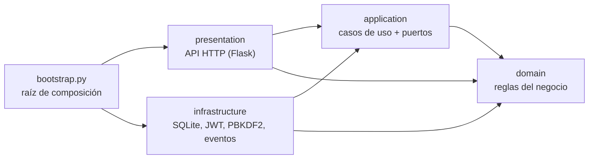

# Sistema POS para negocios pequeños

Backend de punto de venta pensado para tiendas, minimercados, cafeterías y restaurantes pequeños. Cubre el plan **Mediano**: ventas con caja diaria, pagos en efectivo, Nequi, Daviplata, tarjeta y fiado, usuarios con roles, inventario con alertas, clientes con cuentas por cobrar y reportes por día, mes y producto.

El mismo código sirve para cualquier negocio: lo que cambia de un cliente a otro (impuestos, métodos de pago, límite de usuarios, fiados) es **configuración**, y lo que necesita código nuevo (otra base de datos, facturación electrónica) entra por **puntos de extensión** sin tocar las reglas de negocio.

## Arquitectura

Arquitectura limpia en cuatro capas. Las dependencias siempre apuntan hacia adentro: el dominio no conoce a nadie, y Flask y SQLite son detalles intercambiables.



```
src/pos/
├── domain/              Reglas puras: sin frameworks ni base de datos
│   ├── shared/          Dinero (Decimal exacto), errores, entidades, eventos
│   ├── sales.py         Venta: líneas, impuestos, pagos mixtos, vueltas, anulación
│   ├── cash.py          Caja: base, ingresos, retiros, cierre con arqueo
│   ├── catalog.py       Productos con existencia, costo promedio y alerta de stock bajo
│   ├── customers.py     Clientes, cupo de crédito y estado de cuenta
│   ├── payments.py      Tipos de pago y su comportamiento (Strategy)
│   ├── taxes.py         Impuesto incluido o agregado al precio (Strategy)
│   ├── settings.py      Configuración por negocio
│   └── users.py         Roles y permisos
├── application/
│   ├── ports.py         Contratos: repositorios, unidad de trabajo, reloj, tokens...
│   ├── actor.py         Usuario actual y verificación de permisos
│   └── use_cases/       Un caso de uso por clase, agrupados por módulo
├── infrastructure/      Adaptadores: SQLite, PBKDF2, JWT, bus de eventos
├── presentation/http/   Rutas Flask, validación de entrada y JSON de salida
├── bootstrap.py         Conecta todas las piezas (inyección de dependencias)
└── config.py            Variables de entorno
```

### SOLID y patrones, en el código

| Principio o patrón | Dónde se ve |
| --- | --- |
| Responsabilidad única | Cada caso de uso es una clase con un solo `execute` (`CreateSale`, `VoidSale`, `CloseCashSession`...). |
| Abierto/cerrado | Un método de pago nuevo es configuración; un tipo de pago nuevo es una entrada en `payments.py`, sin tocar ventas ni caja. |
| Sustitución de Liskov | `TaxIncludedPolicy` y `TaxExcludedPolicy` son intercambiables donde se espera una `TaxPolicy`. |
| Segregación de interfaces | Un puerto pequeño por necesidad (`Clock`, `PasswordHasher`, `TokenService`, un repositorio por agregado). |
| Inversión de dependencias | Los casos de uso dependen de `ports.py`; SQLite y JWT dependen de esos contratos, no al revés. |
| Unidad de trabajo | Una venta descuenta inventario, mueve la caja y carga el fiado en una sola transacción. |
| Eventos de dominio | `SaleCompleted` y `StockLow` se publican solo después de confirmar la transacción. |
| Raíz de composición | `bootstrap.py` es el único archivo que conoce las clases concretas. |

## Cómo adaptarlo a cada negocio

Sin escribir código, con `PATCH /api/v1/settings`:

| Necesidad del cliente | Campo |
| --- | --- |
| Restaurante con impuesto al consumo del 8 % | `"default_tax_rate": "8"` |
| Precios sin impuesto (ventas a empresas) | `"prices_include_tax": false` |
| Acepta Bancolombia o transferencias | agregar a `payment_methods` uno con `"kind": "electronic"` |
| No fía | `"credit_sales_enabled": false` |
| Vende aunque el sistema marque cero existencias | `"allow_negative_stock": true` |
| Límite de usuarios según el plan vendido | `"max_users": 3` (o `null` sin límite) |
| Datos del tiquete | `business_name`, `tax_id` (NIT), `address`, `phone`, `receipt_footer` |

Con código, en los puntos de extensión previstos:

- **Facturación electrónica DIAN**: crear una clase con el método `issue_for_sale(sale_id)` que llame al API de un proveedor autorizado y pasarla como `invoice_provider` en `build_container`.
- **PostgreSQL o la nube**: implementar los repositorios y la unidad de trabajo de `application/ports.py` en `infrastructure/persistence/postgres/` y cambiar una línea en `bootstrap.py`.
- **Permisos por rol**: ajustar `ROLE_PERMISSIONS` en `domain/users.py`.
- **Alertas por WhatsApp o correo**: suscribir un manejador a `StockLow` o `CashSessionClosed` en `bootstrap.py`.

## Instalación

Requiere Python 3.11 o superior. Funciona igual en Windows y Linux.

```bash
python -m venv .venv
.venv\Scripts\activate          # Windows
source .venv/bin/activate       # Linux o macOS
pip install -r requirements-dev.txt

cp .env.example .env            # en Windows: copy .env.example .env
python manage.py create-admin   # crea el primer administrador
python manage.py runserver      # http://127.0.0.1:8000
```

Con `POS_ENV=development` arranca el servidor de Flask con recarga automática. En producción, defina `POS_ENV=production` y `POS_SECRET_KEY`, y el mismo comando usa waitress. La base de datos es un solo archivo (`data/pos.sqlite3`): para respaldarla basta con copiarlo.

## Recorrido rápido de la API

Todas las rutas, salvo el login y `/health`, piden el encabezado `Authorization: Bearer <token>`. El dinero viaja como texto (`"12500.00"`) para no perder exactitud.

```http
POST /api/v1/auth/login
{"username": "admin", "password": "..."}

POST /api/v1/products
{"sku": "ARROZ-500", "name": "Arroz 500 g", "price": "2500", "barcode": "7702001", "initial_stock": "24", "min_stock": "6"}

POST /api/v1/cash-sessions
{"opening_amount": "50000"}

POST /api/v1/sales
{
  "items": [{"product_id": "…", "quantity": 2}],
  "payments": [{"method": "nequi", "amount": "3000"}, {"method": "efectivo", "amount": "5000"}]
}

POST /api/v1/cash-sessions/current/close
{"counted_amount": "55000"}
```

| Módulo | Rutas (prefijo `/api/v1`) |
| --- | --- |
| Acceso | `POST /auth/login`, `GET /auth/me`, `POST /auth/change-password` |
| Usuarios | `GET /users`, `POST /users`, `PATCH /users/{id}` |
| Configuración | `GET /settings`, `PATCH /settings` |
| Catálogo | `GET/POST /categories`, `GET/POST /products`, `GET /products/lookup?code=`, `GET/PATCH /products/{id}` |
| Inventario | `POST /inventory/purchases`, `POST /inventory/adjustments`, `GET /inventory/low-stock`, `GET /inventory/movements?product_id=` |
| Caja | `POST /cash-sessions`, `GET /cash-sessions`, `GET /cash-sessions/current`, `POST /cash-sessions/current/movements`, `POST /cash-sessions/current/close`, `POST /cash-sessions/{id}/close`, `GET /cash-sessions/{id}` |
| Ventas | `POST /sales`, `GET /sales?from=&to=`, `GET /sales/{id}`, `POST /sales/{id}/void` |
| Clientes | `GET/POST /customers`, `GET/PATCH /customers/{id}`, `GET /customers/{id}/statement`, `POST /customers/{id}/payments` |
| Reportes | `GET /reports/sales-summary?from=&to=&group_by=month`, `GET /reports/top-products?from=&to=` |

Todos los errores tienen la misma forma, con mensajes listos para mostrar al usuario:

```json
{"error": {"code": "insufficient_stock", "message": "Stock insuficiente de «Arroz 500 g»: hay 1 y se piden 2"}}
```

400 dato inválido, 401 sin sesión, 403 sin permiso, 404 no existe, 409 duplicado o conflicto, 422 regla de negocio.

## Pruebas

```bash
python -m pytest                          # o, sin instalar nada extra:
python -m unittest discover -s tests -t .
```

67 pruebas: dominio puro (dinero, impuestos, ventas, caja, productos, clientes), casos de uso completos sobre SQLite real (ventas, fiados, anulaciones, cierres, reportes, límites del plan, zona horaria) y la API HTTP de punta a punta. Incluye una prueba de concurrencia donde dos cajas intentan vender la última unidad al mismo tiempo.

## Decisiones técnicas

- **Dinero con `Decimal`**, nunca `float`: el JSON se lee con `parse_float=Decimal` y se redondea a centavos con `ROUND_HALF_UP`.
- **SQLite en el computador del negocio**: no hay nada que instalar y funciona sin internet. Cada operación usa `BEGIN IMMEDIATE`, así dos cajeros no pueden vender la misma última unidad.
- **Fechas en UTC** y reportes en la zona horaria del negocio (`America/Bogota` por defecto): una venta a las 10 p. m. cuenta en el día correcto.
- **Precio desde el catálogo**: el cliente de la API envía cantidades, nunca precios. Los descuentos piden permiso.
- **Contraseñas con PBKDF2-SHA256** (600.000 iteraciones) y sesiones con JWT firmados. El login tarda lo mismo exista o no el usuario.
- **Autorización en los casos de uso**, no en las rutas: si mañana hay una app de escritorio, los permisos siguen funcionando igual.
- **Historial inmutable**: kárdex de inventario, movimientos de caja y estado de cuenta de clientes nunca se editan, solo se agregan.

## Próximos pasos

1. Frontend en React: pantalla de venta con lector de código de barras, apertura y cierre de caja, panel de reportes.
2. Impresión de tiquetes en impresoras térmicas (ESC/POS).
3. Integración con un proveedor de facturación electrónica autorizado por la DIAN.
4. Adaptador PostgreSQL para clientes con varias sedes o en la nube.
5. Respaldo automático diario del archivo de la base de datos.
